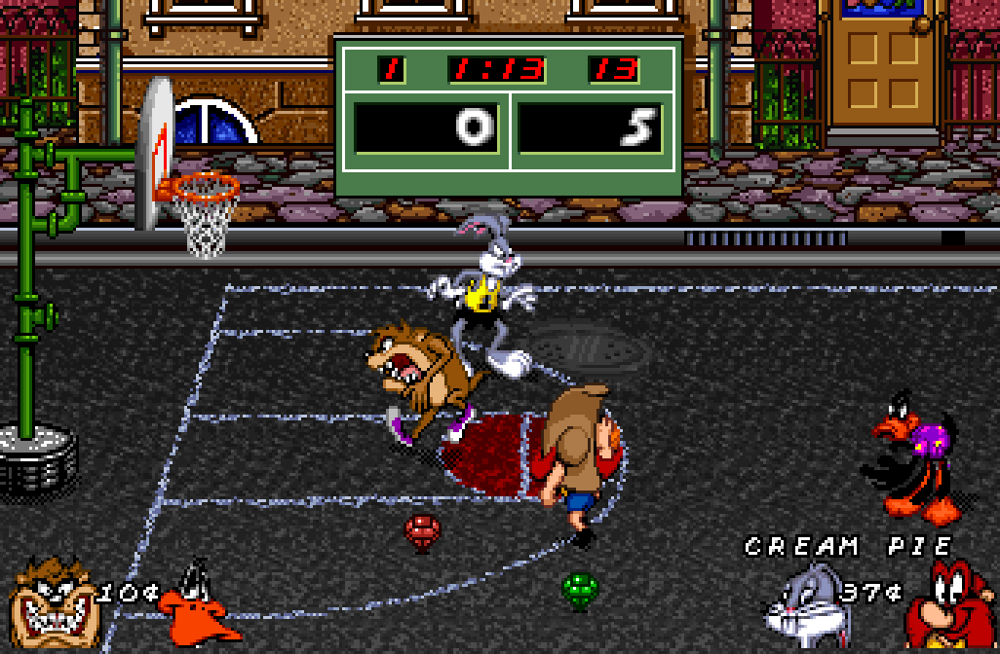
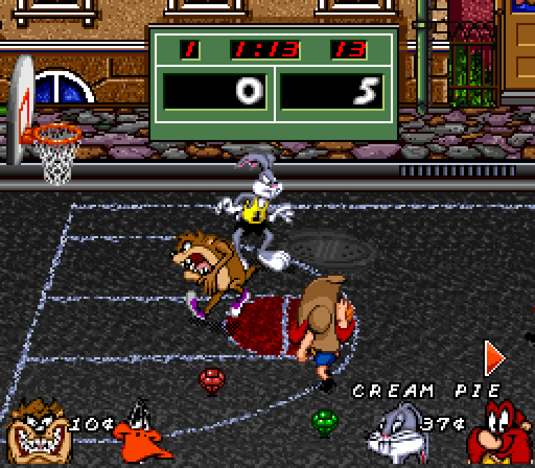
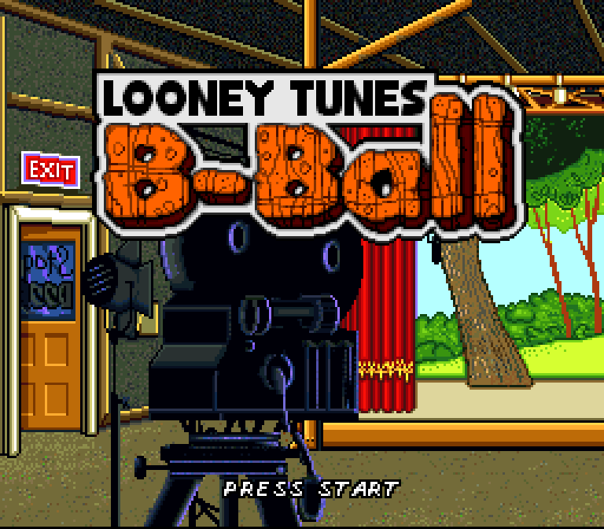
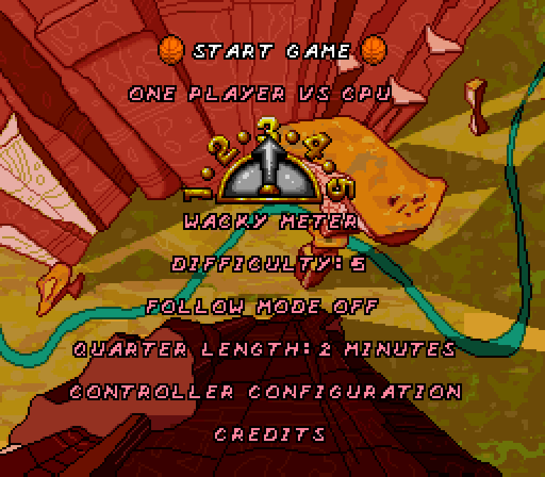
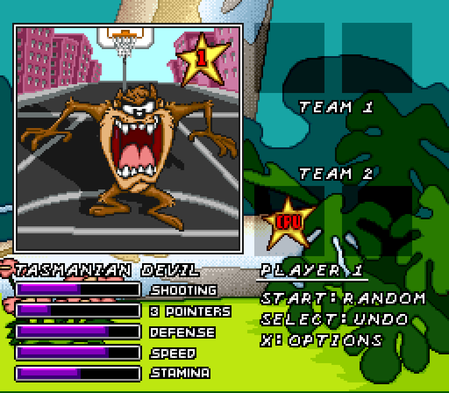
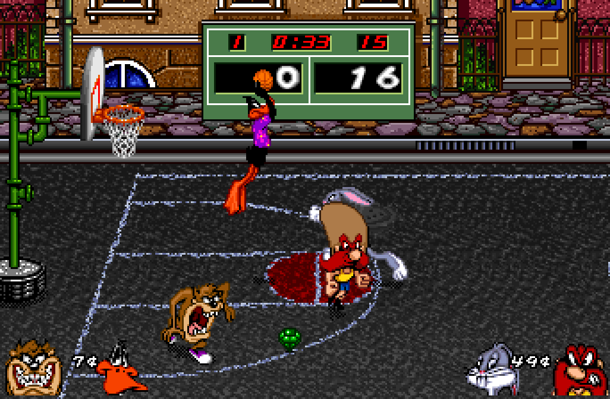
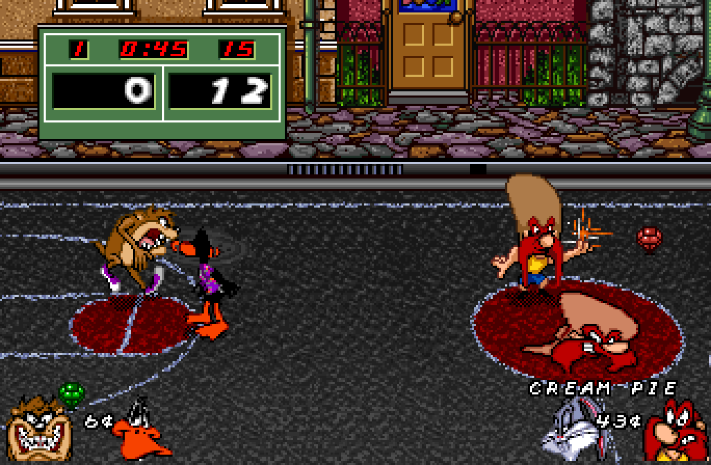
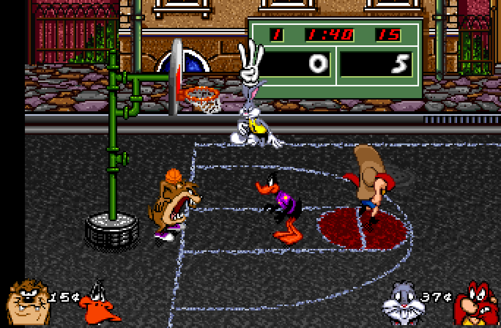

# Looney Tunes B-Ball Recomp



A native recompilation of **Looney Tunes B-Ball** (USA), built on
[snesrecomp](https://github.com/RetroPortingToolKit/snesrecomp).

Two-on-two street basketball from 1995 with Bugs, Daffy, Taz, Yosemite Sam
and the rest, recompiled from the 65816 to native code: the game's own logic
runs as compiled C against an emulated SNES video chip, sound chip and DMA,
with the framework's interpreter as a fallback for code no analysis has
reached. The court can be played in 16:9 widescreen.

> **You must legally own a copy of the game.** No ROM data is distributed with
> this project, in the repository or in any release. The recompiled C is
> generated locally from your own copy and is never committed.

**Just want to play?** Download the latest release from the
[Releases page](https://github.com/SlippyGetBackHere/looney_tunes_b-ball_recomp/releases)
and see [`PLAYING.md`](PLAYING.md): setup, controls, options and how to report
a problem. The rest of this file is for building and developing the port.

## Widescreen

On by default: the launcher's **Aspect ratio** row chooses **16:9
widescreen** or the original **4:3**. In widescreen the court widens to both
sides and everything on it carries on into the extra space: the street, the
buildings, the hoops, the players and the ball. At the far ends of the
court, past where the game's artwork ends, the side is black. The bottom HUD
(portraits, money, power-up names) sits at the screen edges, and the
off-screen arrows point from the widened edges, hidden for players you can
already see. Menus, character select, breaks and the stats screen keep their
4:3 picture.

| 4:3 (the original) | 16:9 widescreen |
|:---:|:---:|
|  |  |
| Daffy is off the screen; the arrow on the right points to him | The court carries on, and Daffy is in view |

It only changes what is drawn: the game plays exactly the same in both modes
(identical game memory throughout a scripted match). How it works and how it
was checked: [`docs/WIDESCREEN.md`](docs/WIDESCREEN.md).

## Screenshots

| | |
|:---:|:---:|
|  |  |
| Title screen | Main menu |
|  |  |
| Character select | Daffy going up for a dunk (widescreen) |
|  |  |
| A Cream Pie power-up in action (widescreen) | At the court's end, the side past the game's artwork is black |

## Status

**Playable** (as of 2026-10-22): boot, attract demo, menus, character
select, exhibition matches through the stats screen, a full one-player
tournament, and two-player games (play-checked in widescreen), on Windows.
The tournament screens have not been checked in widescreen yet.

- **Graphics.** Fixed during the port and checked against bsnes: one-line
  HUD artefacts on the court and under the scoreboard (HDMA ran a line late
  in the framework), and black squares flashing on character select (the
  portrait decompressor overran the frame). The teal line at the bottom of
  Sylvester's character-select screen is in the original game.
- **Audio.** Correct with `VSync = adaptive` (see
  [`PLAYING.md`](PLAYING.md#options)); with plain VSync the music can skip.
- **Native code.** 1,735 compiled variants, seeded from five coverage
  captures of the attract mode and menus, matches and a full tournament
  (`recomp/coverage/`). 147 still run on the interpreter, mostly where the
  analyzer cannot prove how a routine exits; frames take 2-4 ms either way.
- **Mods**: on the launcher's Mods page, all off by default; off, the game
  is the original (the 4:3 picture check matches with the code they hook
  into). *Gameplay options* (`mods/preloaded/packages/looneytunesbball.gameplay`):
  - *Shot clock off* (`src/mod_no_shot_clock.c`): the shot clock's frame
    counter ($0DA7) is put back every frame, so $0DA5 stays at 15 and never
    runs out. The game clock is untouched.
  - *Change tournament difficulty* (`src/mod_tournament_difficulty.c`):
    the menu's input handler at $81:C7AC runs on the interpreter, so the
    mod changes four of its bytes in the cartridge buffer: the branch that
    refuses left/right on Difficulty in tournament modes, and the three
    calls to the menu refresh ($81:CB35, which forces 5), pointed at a helper
    in unused padding ($81:FF60) that runs the refresh with the tournament
    flag hidden. The tournament's own round-by-round rise is kept.
  - *CPU doesn't steal* (`src/mod_cpu_no_steal.c`): the per-frame update's
    call to the player logic ($83:F3AE, interpreted) is pointed at a helper
    in padding ($83:FF40) that clears the steal buttons from the virtual
    buttons the CPU's AI pressed for its defenders when your team has the
    ball: Y (its chasing steal) and X (its swipe within 12 units, $81:946C).
    Options keep X (steals only at close range), apply the same to your CPU
    teammate, or clear B (jump) too.

  *Testing aids*: *Team 1 always wins* (`src/mod_team1_wins.c`) keeps team
  1's score two points ahead once team 2 scores, for playing through a
  tournament while testing.

Open items and what has been ruled out are in
[`KNOWN_ISSUES.md`](KNOWN_ISSUES.md).

## ROM identity

| | |
|---|---|
| File | `Looney Tunes B-Ball (USA).sfc` |
| Publisher | Sunsoft |
| Developer | Sculptured Software |
| Year | 1995 |
| Mapping | lorom |
| Region | USA (North America) |
| Coprocessor | none |
| CRC32 | `6d3bc96f` |
| SHA-256 | `76ba0fc1f5c1f39354bb3173a600f23915f1191f400f7d525d220b4b3c8d958d` |

`tools/regen.sh` refuses to run against anything else, so a mismatched
revision fails immediately instead of producing subtly wrong output.

## Build

On Windows, configure with Ninja and clang (the retcomm `cmake-clang-v1`
toolchain): the default Visual Studio generator uses MSVC, which cannot
compile the framework. The analyzer needs Rust (`cargo`) the first time.

```sh
git clone --recursive https://github.com/SlippyGetBackHere/looney_tunes_b-ball_recomp.git
cd looney_tunes_b-ball_recomp
bash tools/regen.sh --rom "/path/to/Looney Tunes B-Ball (USA).sfc"
cmake -S . -B build -G Ninja -DCMAKE_BUILD_TYPE=Release -DCMAKE_C_COMPILER=clang -DCMAKE_CXX_COMPILER=clang++
cmake --build build -j
```

The `snesrecomp` submodule comes from a fork,
[SlippyGetBackHere/snesrecomp](https://github.com/SlippyGetBackHere/snesrecomp),
branch `local/looney-tunes-b-ball`: upstream plus four fixes this port needs
that are not upstream yet. `git clone --recursive` fetches it.
`patches/README.md` lists the fixes and how to re-apply them to upstream;
`docs/UPSTREAM_ISSUES.md` lists every framework problem the port ran into.

The ROM does not have to live in the repository; keeping it on your own
drive is the better habit, and `SNESRECOMP_ROM` sets the path once for a
shell. Without either, `tools/regen.sh` finds `Looney Tunes B-Ball (USA).sfc`
at the repo root, then the path the setup wizard recorded in `rom.cfg`;
`.gitignore` blocks both from ever being committed.

`tools/regen.sh` verifies the ROM, generates `src/gen/*.c` from the analysis
input and the coverage captures, and re-syncs `recomp/funcs.h`. Re-run it
whenever you change anything under `recomp/`.

## Run

```sh
./build/LooneyTunesBBallSNESRecomp                                          # launcher picks the ROM
./build/LooneyTunesBBallSNESRecomp "/path/to/Looney Tunes B-Ball (USA).sfc" # or name it and skip the launcher
```

With no ROM on the command line the build opens the recomp-ui launcher: a ROM
picker with a verification badge, plus display / audio / input settings. Your
choice is cached in `rom.cfg` beside the executable, so the next launch opens
on it and "Skip launcher on boot" makes it immediate.

Either way the ROM is checked against the digests above before anything
boots: a dump that could not have produced this build is refused at the door
rather than mis-executing ten frames in.

## Layout

| Path | What lives there |
|---|---|
| `recomp/` | Analysis input: `bank*.cfg`, `symbols.toml`, generated `funcs.h` |
| `recomp/coverage/` | Coverage captures that seed the analyzer (addresses and hit counts, no ROM data) |
| `rom_identity.txt` | ROM digests, read by the build, `tools/regen.sh` and CI |
| `src/` | Host code: `main.c` (identity, launcher rows, window), `game_rtl.c` (frame driver), `ltbb_widescreen.c` and `ltbb_oam_widen.c` (widescreen), `mod_team1_wins.c` |
| `src/gen/` | Generated C. Never committed; regenerate locally |
| `snesrecomp/` | Framework submodule (owns `lib/recomp-net`, `lib/retcomm-rbengine`) |
| `mods/` | The preloaded *Testing aids* mod package |
| `tools/` | `regen.sh` (the ROM to C pipeline), `ws_baseline.py` (4:3 picture check) |
| `scripts/` | `package_release.sh`: the player-facing setup pack |
| `patches/` | The framework fixes on the fork branch, one patch per commit, with notes |
| `docs/` | `WIDESCREEN.md`, `UPSTREAM_ISSUES.md` |
| `framework_pins.txt` | Exact framework commits this project is pinned to |
| `KNOWN_ISSUES.md` | Open issues, resolved ones, and what was ruled out |

## How the port works

- **Frame driver** (`src/game_rtl.c`): the framework's beam-aligned driver,
  one frame per PPU field, interrupts taken where the beam latches them.
- **Portrait decompressor** (`recomp/bank83.cfg`): its computed jumps
  (`indirect_dispatch`) and its exits (`exit_mx_variant`) are declared, so it
  and its callers compile, and an interpreted callee stops at the frame
  deadline instead of running past vblank.
- **Sprite emitter** (`recomp/bank00.cfg`, `src/ltbb_oam_widen.c`): the
  routine at `$80:C3C0` that builds the sprite table is wrapped
  (`hle_func`). The original runs unchanged, then a read-only pass adds the
  sprites the game culled at the 4:3 edge that fall in the widescreen
  margins, and adapts the off-screen arrows.
- **Widescreen court** (`src/ltbb_widescreen.c`): the margins are drawn from
  the court's four-screen tilemap strip in video memory, line by line from
  the game's own per-line scroll, so the perspective floor lines up.

## Continuing

- **Coverage.** Capture more of the game as described in
  `snesrecomp/docs/COVERAGE_FEEDBACK.md`, add the capture to
  `recomp/coverage/`, re-run `tools/regen.sh`, rebuild, and check the result
  plays the same.
- **The 4:3 picture.** `python tools/ws_baseline.py compare <route>`
  (`attract`, `match`, `charselect`) replays a scripted route and compares
  every sampled frame with the recorded hashes. Re-record after a regen
  that changes what is compiled.
- **Never edit `src/gen/`** or synthesise a result to get past uncovered
  code. Fix the config or the framework and regenerate.

## Multiplayer

Two players on one PC, one controller each. Netplay is not built into this
target.

## License

This project's own source is under the license in `LICENSE`. The framework
carries its own terms; see `snesrecomp/LICENSE` and
`snesrecomp/THIRD_PARTY_ATTRIBUTION.md`. Neither covers the game data, which
is not distributed here.
